## SQL - indeksy, elementy optymalizacji

---

**Imiona i nazwiska:** Julian Dworzycki, Radosław Klamka

---

Ważne/wymagane są komentarze.

Zamieść kod rozwiązania oraz zrzuty ekranu pokazujące wyniki, (dołącz kod rozwiązania w formie tekstowej/źródłowej)

Zwróć uwagę na formatowanie kodu

---

## Oprogramowanie - co jest potrzebne?

Do wykonania ćwiczenia potrzebne jest następujące oprogramowanie:

- MS SQL Server - wersja 2019, 2022, 2025
- PostgreSQL - wersja 15/16/17/18

- Narzędzia klienckie
  - SSMS
  - Datagrip
  - PgAdmin

Oprogramowanie dostępne jest na przygotowanej maszynie wirtualnej

---

# Przygotowanie

Skonfiguruj połączenie z lokalną bazą Northwind3

- MS SQLServer
  - przykładowa baza danych jest przygotowana jako plik .bak
  - odtwórz bazę z backupu
  - do odtworzenia bazy można wykorzystać
    - SSMS
    - DataGrip (jest plugin który to ułatwia)
    - napisać polecenie SQL

- poniżej oplecenie sql
  - oczywiście należy podać odpowiednie ścieżki

```sql
USE [master]
RESTORE DATABASE [North3]
FROM  DISK = N'<...>/northwind3_19.bak'
WITH  FILE = 1,
MOVE N'Northwind' TO N'<...>/Northwind3.mdf',
MOVE N'Northwind_log' TO N'<...>/Northwind3_1.ldf',  NOUNLOAD,  STATS = 5
```

- Postgresql
  - przykładowa baza danych jest przygotowana jako plik dump
  - odtworzenie bazy należy wykonać w dwóch krokach
    - stworzyć "pustą" bazę Northwind3
    - załadować dane z pliku

- poniżej oplecenie sql tworzące bazę

```sql
create database Northwind3;
```

- poniżej oplecenie wykorzystując pg_restore
  - pg_restore - to jest program - należy uruchomić go w terminalu

```sh
pg_restore -U postgres -d Northwind3 -j 6 Northwind3.dump
```

można też skorzystać z pliku .sql

```sh
docker pull mcr.microsoft.com/mssql/server:2025-latest
docker run -e "ACCEPT_EULA=Y" -e "MSSQL_SA_PASSWORD=zaq1@WSX" -e "MSSQL_PID=Evaluation" -p 1433:1433  --name sql2025 --hostname sql2025 -d mcr.microsoft.com/mssql/server:2025-latest
MSYS_NO_PATHCONV=1 docker cp northwind3_19.bak sql2025:/var/opt/mssql/data/northwind3_19.bak
```

# Przykład 1

Oryginalna baza Northwind jest bardzo mała. Warto zaobserwować działanie na nieco większym zbiorze danych.

Baza Northwind3 zawiera dodatkową tabelę `product_history`

- 2,3 mln wierszy

sprawdź zawartość tabeli `producy_history`

```sql
select count(*) from product_history;

select * from product_history
where id betweeb 1 and 10;
```

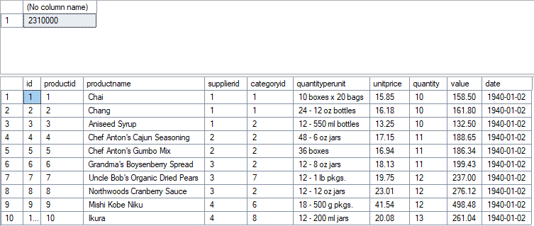

sprawdź jakie indeksy są zdefiniowane dla poszczególnych tabel

MS SQLServer

```sql
sp_helpindex 'product_history';

select
    t.name as table_name,
    i.name as index_name,
    c.name as column_name,
    ic.key_ordinal,
    i.type_desc,
    i.is_primary_key,
    i.is_unique,
    ic.is_included_column
from sys.indexes i
join sys.tables t on i.object_id = t.object_id
join sys.index_columns ic
    on i.object_id = ic.object_id and i.index_id = ic.index_id
join sys.columns c
    on ic.object_id = c.object_id and ic.column_id = c.column_id
where t.is_ms_shipped = 0
 and t.name <> 'sysdiagrams'
      and t.name = 'product_history'
order by t.name, i.name, ic.key_ordinal;
```
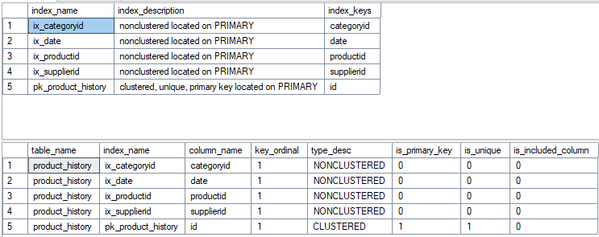

---

# Przykład 2

MS SQL Server
Baza: Northwind3, tabela: products

Napisz polecenie, które zwraca: id produktu, nazwę produktu, cenę produktu, średnią cenę wszystkich produktów.

```sql
select p.productid, p.ProductName, p.unitprice,
    (select avg(unitprice) from products) as avgprice
from products p;
```
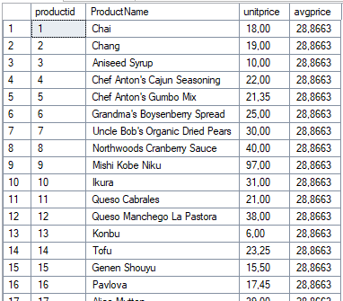

Ustaw raportowanie inf. o czasie oraz liczbie czytanych stron

```sql
set statistics time on

set statistics io on
```

W SSMS włącz opcje: Include Actual Execution Plan

- zaobserwuj
  - czas
  - liczbę odczytywanych stron
  - koszt
  


---

# Zadanie 1

MS SQL Server

Stwórz nową, pustą bazę `Lab1`

```sql
create database lab1;


use [master]
go
alter database [lab1] set recovery simple with no_wait
go
```

Stwórz tabelę `product_history`

- skopiuj oryginalną tabelę `product_history` z bazy Northwind3

```sql
use lab1;

select * into product_history
from North3.dbo.product_history
go
```
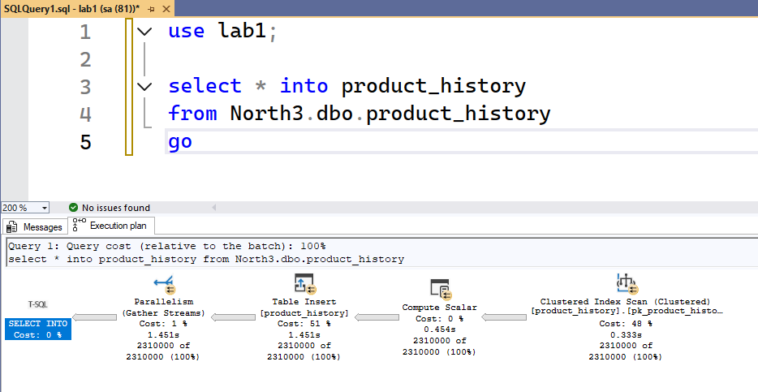
Sprawdź zawartość tabeli oraz indeksy

- tabela nie będzie zawierała żadnych indeksów

ustaw opcje pozwalające na monitorowanie czasu oraz liczby odczytywanych stron

```sql
set statistics time on

set statistics io on
```

Wykonaj kilka eksperymentów, zaobserwuj:

- plan
- czas
- liczbę odczytywanych stron

```sql
select * from product_history
where id = 1000000;
-- 1 wiersz


select * from product_history
where id >= 1000000 and id < 1001000;
-- 1000 wierszy
```
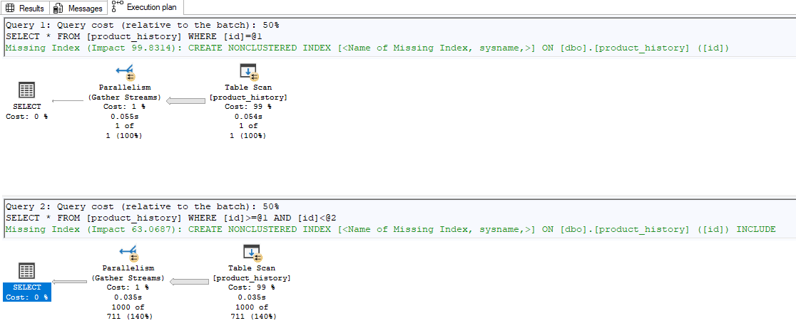

### 1) Brak indeksów

> Wyniki:

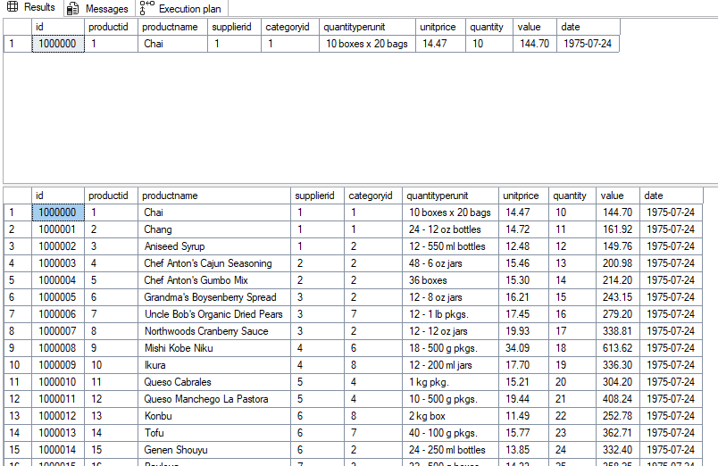

Czas i odczyty: Bardzo wysokie. Ponieważ tabela nie ma żadnego indeksu, silnik bazy danych musi przeczytać  wszystkie strony, aby znaleźć ten 1 lub 1000 wierszy. Koszt zapytania to 100% dla odczytu całej tabeli.

### 2) Nonclustered index

Stwórz indeks

```sql
CREATE INDEX ix_ph_id ON product_history (id);
GO

SELECT * FROM product_history WHERE id = 1000000;
SELECT * FROM product_history WHERE id >= 1000000 AND id < 1001000;

drop index ix_ph_id on product_history;
```
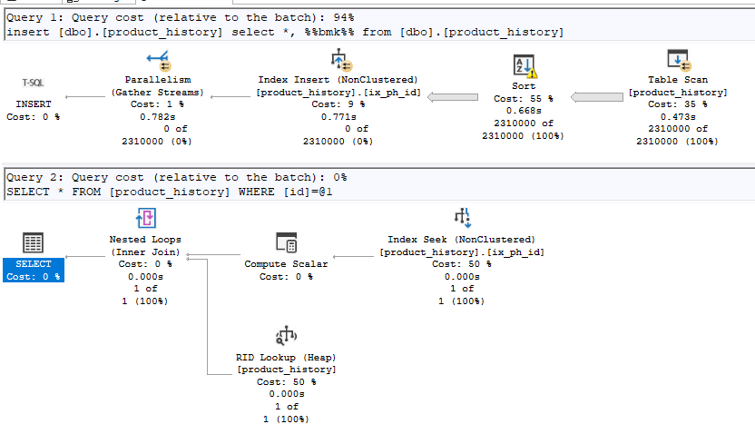

Odczytów jest znacznie mniej niż w Eksperymencie 1. 
Silnik bazy szybko znajduje odpowiednie wartości 'id' w drzewie B-Tree indeksu (Index Seek). 
Jednak zapytanie to 'SELECT *', a indeks zawiera tylko kolumnę 'id' (oraz wskaźnik do wiersza). 
Dlatego dla każdego znalezionego rekordu baza musi wykonać 'RID Lookup'. 
Dla 1 wiersza jest to błyskawiczne. Dla 1000 wierszy wykonuje się 1000 takich skoków.

### 3) Clustered index

Usuń indeks stworzony w pkt 2)

Stwórz indeks

```sql
CREATE UNIQUE CLUSTERED INDEX ixc_ph_id ON product_history (id);
GO

SELECT * FROM product_history WHERE id = 1000000;
SELECT * FROM product_history WHERE id >= 1000000 AND id < 1001000;

SELECT 
    object_name(object_id) AS table_name,
    index_id,
    index_depth,
    index_level,
    page_count 
FROM sys.dm_db_index_physical_stats
(
    db_id(),
    object_id('dbo.product_history'),
    NULL,
    NULL,
    'detailed'
);

SELECT 
    object_name(object_id) AS table_name,
    SUM(in_row_data_page_count) AS data_pages 
FROM sys.dm_db_partition_stats 
WHERE object_id = object_id('dbo.product_history') 
GROUP BY object_id;
```

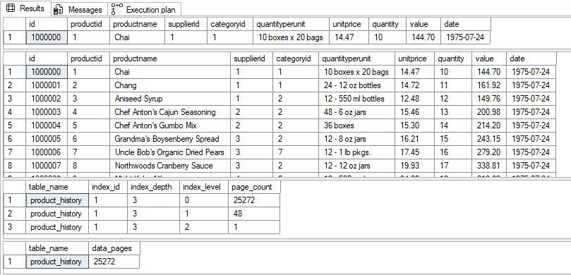
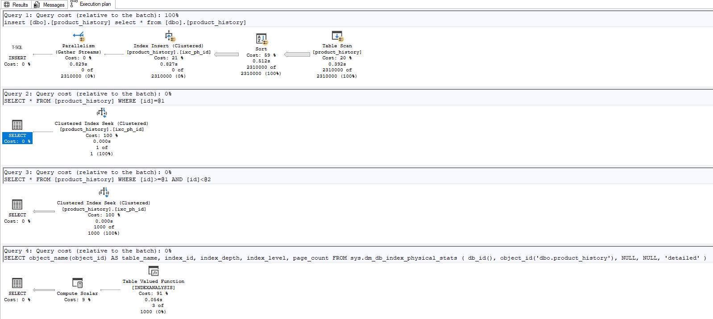
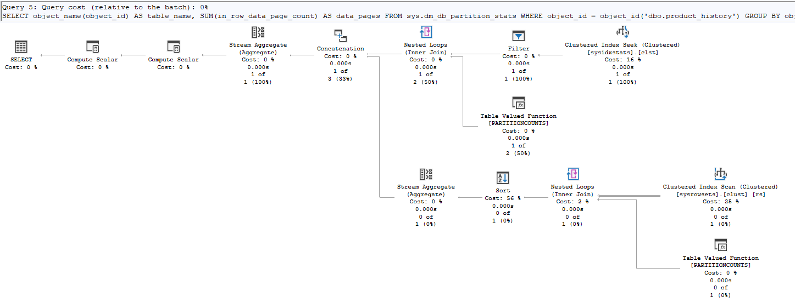

Wykorzystując widok sys.dm_db_index_physical_stats,  widzimy fizyczną strukturę naszego indeksu sklastrowanego. Drzewo B-Tree osiągnęło w tym przypadku głębokość 3 poziomów

Struktura drzewa rozkłada się następująco:
 - index_level = 2 (Root): 1 strona
 - index_level = 1 (intermediate): 48 stron
 - index_level = 0 (Leaf): 25 272 stron

Oznacza to, że aby znaleźć jeden konkretny rekord dla zapytania 'id = 1000000', 
SQL Server odczytuje zaledwie 3 strony (Logical Reads = 3).

# Przykład 3

MS SQL Server

Wygeneruj tabelę o jeszcze większej liczbie wierszy

- np. 100 mln

UWAGA:

- wygenerowanie takiej tabeli wymaga odpowiednich zasobów komputera
  - czas generowania tabeli to kilka min
  - rozmiar ok 2GB
- jeśli twój komputer ma "niewystarczające zasoby" możesz zmniejszyć rozmiar tabeli

```sql
--- tabela 100 mln wierszy
drop table if exists bigtable;
go

with
l0 as (select 1 as c from (values(0),(0),(0),(0),(0),(0),(0),(0),(0),(0)) v(n)), -- 10
l1 as (select 1 as c from l0 a cross join l0 b),       -- 100
l2 as (select 1 as c from l1 a cross join l1 b),       -- 10 000
l3 as (select 1 as c from l2 a cross join l2 b),       -- 100 mln
n as
(
    select top (100000000)
        row_number() over (order by (select null)) as id
    from l3
)
select
    cast(id as int) as id,
    cast(id as varchar(50)) as val
into bigtable
from n;
go
```
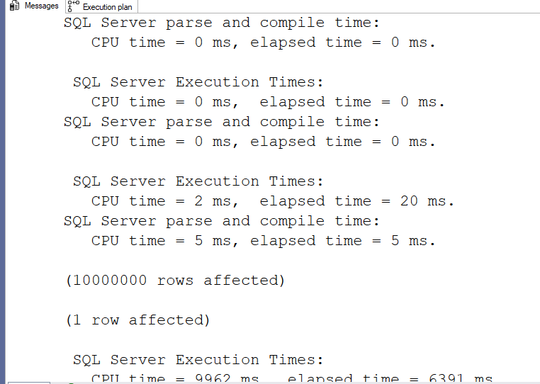
```sql
select count(*) from bigtable;

-- rozmiar tabeli
select
    object_name(object_id) as table_name,
    sum(in_row_data_page_count) * 8.0 / 1024 as data_mb,
    sum(in_row_data_page_count) * 8.0 / 1024 / 1024 as data_gb
from sys.dm_db_partition_stats
where object_id = object_id('dbo.bigtable')
group by object_id;
```

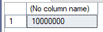

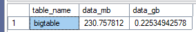

Wykonaj kilka eksperymentów

- bez indeksu
- z indeksem nonclustered, clustered
- zaobserwuj:
  - plan
  - czas
  - liczbę odczytywanych stron
  - sprawdź głębokość drzewa indeksu

---

> Wyniki:

```sql
--  ...
```

# Zadanie 2

MS SQL Server

Wracamy do tabeli `product_history`

- powinien istnieć indeks clustered (kolumna id)

Tym razem warunek zapytań będzie dotyczył atrybutu `date`

```sql
select date, productid, productname, value
from product_history
where date >= '2019-01-01' and date <= '2019-01-31'
```

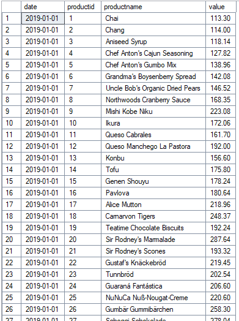

Wykonaj kilka eksperymentów

- bez indeksu
- z indeksem nonclustered, clustered
- zaobserwuj:
  - plan
  - czas
  - liczbę odczytywanych stron
  - sprawdź głębokość drzewa indeksu
  - porównaj wyniki

### 1) Brak indeksu dla atrybutu date

```sql
select date, productid, productname, value
from product_history
where date >= '2019-01-01' and date <= '2019-01-31'
```


### 2) Indeks

```sql
create index ix_ph_date
on product_history (date);

-- usunięcie indeksu
drop index ix_ph_date on product_history;
```

```sql
select date, productid, productname, value
from product_history
where date >= '2019-01-01' and date <= '2019-01-31'
```

> Wyniki:

```sql
--  ...
```

### 3) Indeks pokrywający

usuń indeks stworzony w pkt 1)

stwórz indeks pokrywający (include)

```sql
create index ix_ph_date_incl
on product_history (date) include(productid, productname, value);

drop index ix_ph_date_incl on product_history;
```

```sql
select date, productid, productname, value
from product_history
where date >= '2019-01-01' and date <= '2019-01-31'
```

> Wyniki:

```sql
--  ...
```

zapytanie `select *`

- styczeń 2019

```sql
select *
from product_history
where date >= '2019-01-01' and date <= '2019-01-31'
```

- cały rok 2019

```sql
select *
from product_history
where date >= '2019-01-01' and date <= '2019-12-31'
```

> Wyniki:

```sql
--  ...
```

a gdyby nie było tego indeksu pokrywającego

```sql
drop index ix_ph_date_incl on product_history;
```

```sql
select date, productid, productname, value
from product_history
where date >= '2019-01-01' and date <= '2019-01-31'
```

> Wyniki:

```sql
--  ...
```

### 3) zapytanie wykorzystujące funkcje

```sql
select date, productid, productname, value
from product_history
where year(date) = 2019 and month(date) = 1
```

Czy indeks został użyty? Skomentuj sytuację

> Wyniki:

```sql
--  ...
```

# Zadanie 3

Baza Northwind3

dla każdego wiersza w tabeli `product` podaj

- `productid, categoryid, unitprice`,
- oraz średnią cenę z kategorii do której należy produkt

### 1) MS SQL Server

```sql
use Noirthwind3
```

```sql
select productid, categoryid, unitprice,
       (select avg(unitprice) from products where p.categoryid = products.categoryid) as av
from products p
where unitprice > (select avg(unitprice) from products where p.categoryid = products.categoryid)

select * from
(select productid, categoryid, unitprice,
       (select avg(unitprice) from products where p.categoryid = products.categoryid) as av
from products p) t
where unitprice > av

select p.productid, p.categoryid, unitprice, av
from products p join
    (select categoryid, avg(unitprice) as av
     from products
     group by categoryid) cav on p.categoryid = cav.categoryid
where unitprice > cav.av
```

porównaj:

- plany poszczególnych zapytań
  - czy plany są podobne?
  - jeśli tak dla których zapytań?
- czas
- koszt
- liczbę odczytywanych stron

> Wyniki:

```sql
--  ...
```

### 2) Postgres

porównaj:

- plany poszczególnych zapytań
  - czy plany są podobne?
  - jeśli tak dla których zapytań?
- czas
- koszt
- liczbę odczytywanych stron

```sql
select productid, categoryid, unitprice,
       (select avg(unitprice) from products where p.categoryid = products.categoryid) as av
from products p
where unitprice > (select avg(unitprice) from products where p.categoryid = products.categoryid)

select * from
(select productid, categoryid, unitprice,
       (select avg(unitprice) from products where p.categoryid = products.categoryid) as av
from products p) t
where unitprice > av

select p.productid, p.categoryid, unitprice, av
from products p join
    (select categoryid, avg(unitprice) as av
     from products
     group by categoryid) cav on p.categoryid = cav.categoryid
where unitprice > cav.av
```

> Wyniki:

```sql
--  ...
```

Porównaj wyniki dla MSSQL Server i Postgres

# Zadanie 4

Baza Northwind3

- podobne zapytanie ale tym razem "większa" tabela

dla każdego wiersza w tabeli `product_history` podaj

- `id, productid, categoryid, unitprice`,
- oraz średnią cenę z kategorii do której należy produkt

tabela `product_history` ma 2.3mln wierszy

- ograniczymy rozmiar zbioru wynikowego
- `where id between 1000000 and 1001000`
  - w wyniku będzie 325 wierszy

```sql
with t as
(
  select id, productid, categoryid, unitprice,
       (select avg(unitprice) from product_history where p.categoryid = product_history.categoryid) as av
  from product_history p
  where unitprice > (select avg(unitprice) from product_history where p.categoryid = product_history.categoryid)
)
select * from t
where id between 1000000 and 1001000
-- 325 wierszy


with t as
(
  select * from
    (select id, productid, categoryid, unitprice,
       (select avg(unitprice) from product_history where p.categoryid = product_history.categoryid) as av
     from product_history p) t
  where unitprice > av
)
select * from t
where id between 1000000 and 1001000;


with t as
(
  select p.id, p.productid, p.categoryid, unitprice, av
  from product_history p join
    (select categoryid, avg(unitprice) as av
      from product_history
      group by categoryid) cav on p.categoryid = cav.categoryid
   where unitprice > cav.av
)
select * from t
where id between 1000000 and 1001000;
```

spróbuj wykonać zapytania dla

- MSSQL Server
- Postgresql

porównaj czas wykonania zapytań (jeśli się uda)

- jeśli zapytanie będą się wykonywały "bardzo długo" przerwij je

# Zadanie 5

Baza Northwind3

```sql
select id, productid, productname, date, value,
       (select sum(value) from product_history ph_inn
                        where ph_inn.id <= ph.id) as v
from product_history ph
where id between 100000 and 100800
```

Sprawdź plan i czas wykonania zapytania

- MS SQL Server
- Postgres

Czy da się poprawić wydajność?
Jak?

- dodatkowe indeksy?
- inny sposób?

Podpowiedź

- Może warto zapisać zapytanie w inny sposób
